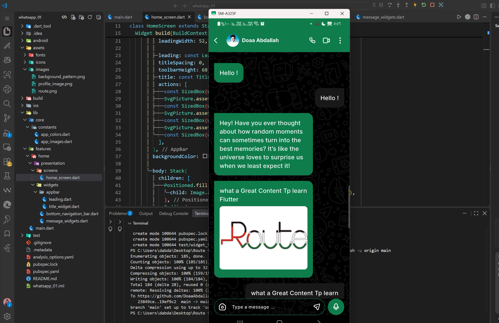

# WhatsApp UI Clone 💬

A Flutter project that recreates the WhatsApp chat interface with a clean and responsive UI.

## 📱 Preview



## ✨ Features

- Custom WhatsApp-style AppBar.
- Chat message bubbles.
- Support for text and image messages.
- Responsive message layouts.
- Custom chat background.
- Message input field UI.

## 🛠️ Built With

- Flutter
- Dart
- SVG Assets

## 🚀 Getting Started

Clone the repository:

```bash
git clone https://github.com/DoaaAbdallah1/whatsapp.git
```

Navigate to the project directory:

```bash
cd whatsapp
```

Install dependencies:

```bash
flutter pub get
```

Run the application:

```bash
flutter run
```

## 👩‍💻 Developer

**Doaa Selim**

